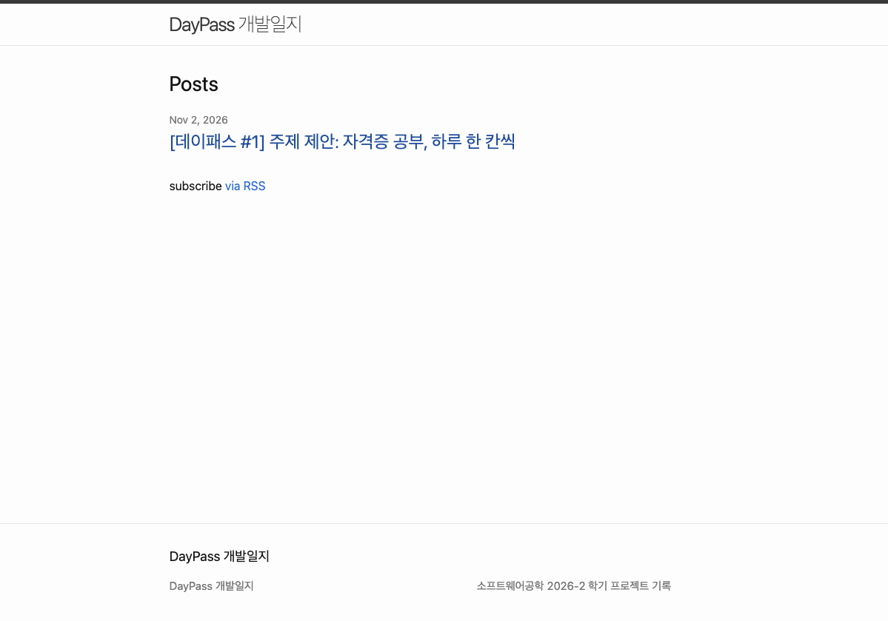

fisrt of all, let me check if this blog works well!!!

---
> 소프트웨어공학(2026-2) 학기 프로젝트 개발일지 첫 번째 글. 무엇을 만들지, 그리고 주제가 어떻게 바뀌었는지 정리한다.

## 처음 생각한 주제: 우리 학과 취업 로드맵

우리 학과(시스템경영·안전공학부)는 졸업 후 진로가 정말 다양하다. 품질, 안전, 물류, 데이터, 개발까지. 그런데 "내가 원하는 진로로 가려면 뭘 준비해야 하지?"라고 물으면 답해 줄 곳이 마땅치 않고, 선후배 교류도 많지 않은 편이다.

그래서 처음엔 진로 분야와 남은 학기를 입력하면, 선배들의 스펙과 채용공고를 바탕으로 자격증·활동 로드맵을 추천해 주는 서비스를 생각했다.

✏️ (내가 이 주제를 고른 이유 한두 줄)

## 교수님 피드백: 두 가지 문제

수업 시간에 주제를 말씀드렸더니 두 가지를 짚어 주셨다.

| 피드백 | 왜 문제인가 |
|---|---|
| 사용성 평가가 어렵다 | 추천한 로드맵이 맞았는지는 그걸 따라간 학생이 취업할 때, 즉 몇 년 뒤에야 알 수 있다 |
| 데이터 모으기가 오래 걸린다 | 선배 스펙, 인터뷰 10명, 채용공고를 미리 다 모아야 서비스가 돌아간다 |

다시 생각해 보니 두 문제는 뿌리가 같았다. 서비스의 가치가 **내가 미리 모아 둔 데이터**에서 나오는 구조였던 것이다. 데이터가 없으면 빈 껍데기고, 효과는 학기 안에 확인할 수 없다.

✏️ (피드백을 듣고 든 생각 한 줄)

## AI와 토론하며 주제 다듬기

혼자 고민하는 대신 AI(Claude)와 토론하면서 방향을 잡았다. 먼저 새 주제를 거를 기준 세 가지를 세웠다.

1. 데이터가 사용자 입력으로 생기나, 내가 미리 모아야 하나?
2. 나나 친구가 이번 주에 바로 써 볼 수 있나?
3. 잘 되는지를 몇 주 안에 확인할 수 있나?

이 기준으로 여러 아이디어를 걸렀다.

- **자격증 추천만 하기** → 한 번 쓰고 끝난다. 다시 들어올 이유가 없다.
- **시험 공부 계획표** (따로 메모해 둔 아이디어) → 평가는 쉽지만 진로와 무관해진다.
- **둘을 합치기: 필요한 자격증을 고르고, 그 공부를 도와주기** → 채택
- **공기업만 대상으로 하기** → 가이드는 명확해지지만, 기관별 가산점 정보를 모으느라 데이터 문제가 다시 생긴다. 보류
- **인터넷 검색으로 맞춤 꿀팁을 자동으로 가져오기** → 광고 글이 섞이고, 무료 API 한도와 발표 날 시연 실패 위험이 있다. 이번 버전에서는 제외
- **사용자 유형별 공부법 추천** → 채택. 단, "시각형/청각형" 같은 학습 스타일이 아니라 **상황**으로 나누기로 했다. 학습 스타일에 맞춰 가르치면 더 잘 배운다는 주장은 연구로 거의 뒷받침되지 않는다(Pashler 외, 2008).

중간에 공부 계획 기능은 너무 어려울 것 같아 빼자고 했다가, 결국 그게 서비스의 핵심이라 다시 넣었다. 대신 AI가 계획을 짜는 게 아니라 **정해진 규칙으로 만드는 방식**을 택했다. 같은 조건이면 항상 같은 코스가 나오고, 외부 서비스에 기대지 않으니 시연도 안정적이다.

✏️ (이 과정에서 배운 점 한두 줄)

## 최종 주제: 데이패스

> 자격증이 필요하지만 무엇을, 언제, 어떻게 공부할지 막막한 산업공학 계열 학생이, 자기 수준과 남은 기간에 맞는 Day 단위 코스를 듀오링고처럼 하루씩 따라가며 자격증을 준비하는 웹 서비스

- **누가:** 우리 학과 학생 (첫 테스터는 학과 친구들)
- **어떤 불편:** 무엇을 딸지 모름 / 공부법을 직접 찾아야 함 / 혼자선 꾸준히 못 함
- **무엇을:** 자격증 추천 + 시험 일정 안내 + 상황별 맞춤 Day 코스

## 이렇게 쓴다

데이터 쪽에 관심 있는 2학년이라면 이렇게 쓰게 된다.

1. 관심 분야 "데이터"를 고르면 ADsP, SQLD가 추천되고, 한국사·어학 같은 기본 스펙이 따로 보인다.
2. ADsP를 골라 시험일을 넣고, "이 범위를 공부해 본 적 있나요?"에 답한다.
3. 시험까지 14일, 처음 공부 → **벼락치기 생존형**으로 판정된다.
4. Day 1~14 코스가 만들어지고, 매일 오늘 할 일을 체크하면 진행률과 연속 기록이 쌓인다.

## 학습자 유형 4가지

|  | 시험까지 2주 이하 | 2주 넘게 |
|---|---|---|
| **처음 공부** | A. 벼락치기 생존형 | B. 기초 다지기형 |
| **어느 정도 앎** | C. 실전 압축형 | D. 점검 심화형 |

유형마다 코스 구성이 다르다. 근거로 삼은 연구는 이렇다.

- 초보자는 풀이 예제부터, 아는 사람은 문제 풀이부터 (Kalyuga 외, 2003)
- 오래 기억하려면 복습 간격을 넓게 (Cepeda 외, 2008) → 단기 유형은 2일, 장기 유형은 4일마다 복습
- 다시 읽기보다 떠올려 보기 (Roediger & Karpicke, 2006; Dunlosky 외, 2013) → 매일 문제로 마무리

단계별 비율 같은 세부 숫자는 연구가 정해 주지 않아서, 친구들 테스트 결과를 보고 조정할 계획이다.

## 다루는 자격증

- **학과 대표:** 품질경영기사, 산업안전기사, 정보처리기사, 물류관리사
- **데이터:** ADsP, SQLD
- **기본 스펙:** 한국사능력검정시험, TOEIC, TOEIC Speaking, TOEFL, IELTS

11개 모두 정보와 일정을 보여 주고, Day 코스는 이번 학기엔 **ADsP 하나만** 만든다. 응시 자격 제한이 없어 학년 상관없이 테스트할 친구를 찾기 쉽고, 과목 구성이 분명해서다.

## 이번 학기에 어디까지

| 시기 | 목표 |
|---|---|
| 11/9 | 데이터 설계(ERD), 블로그 2편 |
| 11/16 | 첫 배포: 자격증 목록·상세, 목표 추가·목록, 블로그 3편 |
| 11/27 | 유형 판정, 코스 생성, 오늘 할 일, 완료 체크 |
| 11/27~12/6 | 친구 테스트와 개선 |
| 12/7~8 | 최종 제출, 발표 |

**이번엔 안 만드는 것:** AI·검색 기반 팁, PDF 인식, 알림, 로그인, ADsP 외 코스. 다음 버전 후보로 남겨 둔다.

## 잘 되는지 어떻게 확인할까

- 친구 3~5명에게 "ADsP 목표 만들고 Day 1 끝내기"를 맡기고, 걸린 시간과 막힌 곳을 기록한다.
- 1~2주 동안 해야 했던 Day 중 실제로 완료한 비율을 본다. 이 기록은 DB에 자동으로 쌓인다.

처음 기획의 약점이던 "몇 년 뒤에야 알 수 있다"를 "몇 주 안에 숫자로 확인한다"로 바꾼 것이 이번 주제 변경의 핵심이다.

## 다음 글

2편에서는 테이블과 관계를 그린 ERD 초안을 정리할 예정이다.

---

### 참고한 연구

- Cepeda, N. J., Vul, E., Rohrer, D., Wixted, J. T., & Pashler, H. (2008). Spacing effects in learning: A temporal ridgeline of optimal retention. *Psychological Science, 19*(11), 1095–1102.
- Dunlosky, J., Rawson, K. A., Marsh, E. J., Nathan, M. J., & Willingham, D. T. (2013). Improving students' learning with effective learning techniques. *Psychological Science in the Public Interest, 14*(1), 4–58.
- Kalyuga, S., Ayres, P., Chandler, P., & Sweller, J. (2003). The expertise reversal effect. *Educational Psychologist, 38*(1), 23–31.
- Pashler, H., McDaniel, M., Rohrer, D., & Bjork, R. (2008). Learning styles: Concepts and evidence. *Psychological Science in the Public Interest, 9*(3), 105–119.
- Roediger, H. L., & Karpicke, J. D. (2006). Test-enhanced learning. *Psychological Science, 17*(3), 249–255.
