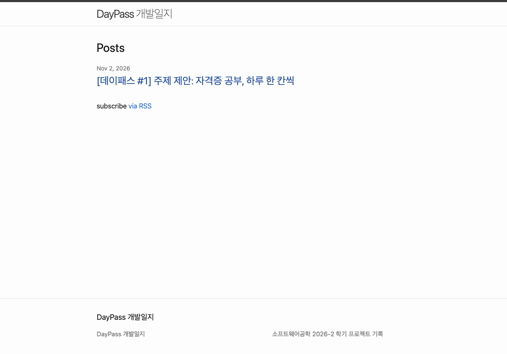

fisrt of all, let me check if this blog works well!!!

---
> 소프트웨어공학(2026-2) 학기 프로젝트 개발일지 첫 번째 글. 무엇을 만들지, 그리고 주제가 어떻게 바뀌었는지 정리한다.

## 처음 생각한 주제: 우리 학과 취업 로드맵

우리 학과(시스템경영·안전공학부)는 졸업 후 진로가 정말 다양하다. 품질, 안전, 물류, 데이터, 개발까지. 그런데 "내가 원하는 진로로 가려면 뭘 준비해야 하지?"라고 물으면 답해 줄 곳이 마땅치 않고, 선후배 교류도 많지 않은 편이다.

그래서 처음엔 진로 분야와 남은 학기를 입력하면, 선배들의 스펙과 채용공고를 바탕으로 자격증·활동 로드맵을 추천해 주는 서비스를 생각했다.

✏️ (내가 이 주제를 고른 이유 한두 줄)

## 교수님 피드백: 두 가지 문제

수업 시간에 주제를 말씀드렸더니 두 가지를 짚어 주셨다.

| 피드백 | 왜 문제인가 |
|---|---|
| 사용성 평가가 어렵다 | 추천한 로드맵이 맞았는지는 그걸 따라간 학생이 취업할 때, 즉 몇 년 뒤에야 알 수 있다 |
| 데이터 모으기가 오래 걸린다 | 선배 스펙, 인터뷰 10명, 채용공고를 미리 다 모아야 서비스가 돌아간다 |

다시 생각해 보니 두 문제는 뿌리가 같았다. 서비스의 가치가 **내가 미리 모아 둔 데이터**에서 나오는 구조였던 것이다. 데이터가 없으면 빈 껍데기고, 효과는 학기 안에 확인할 수 없다.

✏️ (피드백을 듣고 든 생각 한 줄)

## AI와 토론하며 주제 다듬기

혼자 고민하는 대신 AI(Claude)와 토론하면서 방향을 잡았다. 한 번에 정해진 게 아니라, 실제로 만들어 보면서 네 번 크게 바뀌었다. (각 단계 제목을 누르면 내용이 펼쳐진다.)

<strong>1차: 자격증 추천 + 상황별 Day 코스</strong>

먼저 새 주제를 거를 기준 세 가지를 세웠다.

1. 데이터가 사용자 입력으로 생기나, 내가 미리 모아야 하나?
2. 나나 친구가 이번 주에 바로 써 볼 수 있나?
3. 잘 되는지를 몇 주 안에 확인할 수 있나?

이 기준으로 여러 아이디어를 걸렀다.

- **자격증 추천만 하기** → 한 번 쓰고 끝난다. 다시 들어올 이유가 없다.
- **시험 공부 계획표** (따로 메모해 둔 아이디어) → 평가는 쉽지만 진로와 무관해진다.
- **둘을 합치기: 필요한 자격증을 고르고, 그 공부를 도와주기** → 채택
- **공기업만 대상으로 하기** → 가이드는 명확해지지만, 기관별 가산점 정보를 모으느라 데이터 문제가 다시 생긴다. 보류
- **인터넷 검색으로 맞춤 꿀팁을 자동으로 가져오기** → 광고 글이 섞이고, 무료 API 한도와 발표 날 시연 실패 위험이 있다. 이번 버전에서는 제외
- **사용자 유형별 공부법 추천** → 채택. 단, "시각형/청각형" 같은 학습 스타일이 아니라 **상황**으로 나누기로 했다. 학습 스타일에 맞춰 가르치면 더 잘 배운다는 주장은 연구로 거의 뒷받침되지 않는다(Pashler 외, 2008).

중간에 공부 계획 기능은 너무 어려울 것 같아 빼자고 했다가, 결국 그게 서비스의 핵심이라 다시 넣었다. 대신 AI가 계획을 짜는 게 아니라 **정해진 규칙으로 만드는 방식**을 택했다. 같은 조건이면 항상 같은 코스가 나오고, 외부 서비스에 기대지 않으니 시연도 안정적이다.

✏️ (이 과정에서 배운 점 한두 줄)

<strong>2차: "내가 만든 공부 계획표, 믿어도 될까?"</strong>

코스를 만들고 나니 이 계획표가 정말 효과적인지 믿음이 가지 않았다. 그래서 듀오링고 같은 학습 앱은 단계를 어떤 기준으로 짜는지, 연구는 뭐라고 하는지 AI와 같이 조사했다.

| 원칙 | 학습 앱에서는 | 연구 근거 |
|---|---|---|
| 간격을 넓혀 가며 다시 보기 | 듀오링고는 레슨 순서를 간격 반복으로 정한다. 배운 직후 금방 다시 보고, 그 뒤 간격을 점점 넓힌다. | 가장 좋은 복습 간격은 시험이 1주 뒤면 남은 기간의 20~40%, 1년 뒤면 5~10%다 (Cepeda 외, 2008) |
| 떠올려 보기 | 레슨 자체가 문제 풀이이고, 끝에 틀린 문제를 다시 본다. | 다시 읽기보다 시험 보듯 떠올리는 쪽이 오래 남는다 (Roediger & Karpicke, 2006) |
| 섞어 풀기 | 여러 스킬의 레벨을 학습 경로 위에 섞어 배치한다. | 효과가 중간 정도로 평가된다 (Dunlosky 외, 2013) |
| 결과에 맞춰 조정 | 맞힌 정도와 간격으로 복습할 내용을 고르고, 단어마다 기억이 얼마나 남았는지 예측하는 모델을 쓴다 (Settles & Meeder, 2016). | 기준에 못 미친 내용은 간격을 두고 다시 학습해야 한다 (Rawson & Dunlosky, 2011) |

이 기준으로 실제 ADsP 코스를 여러 조건으로 뽑아 점검했더니 문제가 보였다.

- 2주짜리 초보 코스의 Day 1에 시험의 60%(R기초·통계분석·데이터 마이닝)가 한꺼번에 몰렸다.
- 문제 풀이를 하루도 하지 않는 과목이 생겼다. 과목별 과락(40% 미만)이 있어서 위험하다.
- 한 단원을 배운 뒤 14일 동안 다시 나오지 않는 경우가 있었다.

개선안 중 먼저 **"결과에 맞춰 조정하기"**를 넣었다. 매일 완료 체크를 할 때 마무리 문제를 몇 개 맞혔는지 입력한다. 정답률이 60%(합격선) 미만이면 다음 Day에 그 단원 10분 보충 복습이 붙고, 마지막 날 최종 점검에는 약했던 단원이 모여서 나온다. 듀오링고의 개인화 연습을 AI 없이 규칙으로 흉내 낸 셈이다. 나머지 두 문제(하루 분량 쏠림, 과목 누락)는 고칠 목록에 올려 두었다.

✏️ (조사하면서 든 생각 한 줄)

<strong>3차: 내 자료(PDF·유튜브)로 코스와 퀴즈를? → 접음</strong>

원래 진짜 하고 싶었던 건 이거였다. 공부할 자료(요약 PDF, 유튜브 강의)를 넣으면 그걸로 Day별 공부 범위를 정하고, 그 내용으로 확인 퀴즈까지 내 주는 것.

토론해 보니 두 부분의 난이도가 전혀 달랐다.

- **자료 → 계획:** 목차, 쪽수, 영상 순서만 알면 규칙으로 할 수 있다.
- **자료 → 내용 퀴즈:** 내용을 이해해서 문제를 만드는 건 사실상 AI가 필요하다. 그러면 "무료 플랜만 쓴다"는 과제 조건, "같은 입력이면 같은 결과"라는 원칙, 남의 교재를 외부 AI 서비스로 보내는 저작권 문제와 모두 부딪힌다.

AI는 대안으로 "검증된 무료 강의를 골라 두고 문제 은행을 직접 만들자"고 했다. 듀오링고나 칸아카데미도 사용자가 자료를 올리는 게 아니라, 회사가 만든 콘텐츠로 코스를 짜기 때문이다. 하지만 강의 자료를 골라서 제공하는 건 인강 플랫폼 같은 상업 서비스에 가깝고, 기말 프로젝트의 취지와는 맞지 않는다고 판단해서 접었다.

대신 방향을 바꿨다. **콘텐츠를 주는 서비스가 아니라, 내 공부를 계획하고 점검하고 고쳐 주는 코치.** 교육심리학에서 말하는 자기조절학습(계획 → 실행 → 점검 → 조정을 반복하는 것, Zimmerman, 2002)을 돕는 쪽이다.

✏️ (방향을 바꾸면서 든 생각 한 줄)

<strong>4차: 내 일정에 맞춘 공부 스케줄 → 채택</strong>

콘텐츠 없이 개인화할 수 있는 방법을 여러 개 놓고 고민했다. 단원별 자기진단, 내 교재 분량 입력, 밀린 날 다시 짜기, 요일별 공부 시간, 주간 회고 등이다. 그중 대학생에게 가장 현실적인 문제를 골랐다. **수업·알바·근로 때문에 요일마다 공부할 수 있는 시간이 다르다**는 것이다.

- 매주 시간표(수업·알바·근로)와 시험 기간·여행 같은 날짜 일정을 넣으면, 남는 시간으로 요일별 공부 시간을 추천한다. 추천값은 요일마다 고칠 수 있다.
- 공부할 수 없는 날은 비우고, 시간이 많은 날은 할 일을 더 담는다.
- 일주일마다 결과를 돌아보고 남은 계획을 다시 짜는 주간 점검을 붙인다.
- 근거: "언제 공부할지" 구체적으로 정해 두면 실천률이 올라간다(Gollwitzer & Sheeran, 2006). 사람은 일에 걸리는 시간을 늘 적게 잡기 때문에 실제 일정을 반영해야 한다(Buehler 외, 1994).

## 최종 주제: 데이패스

> 자격증이 필요하지만 무엇을, 언제, 어떻게 공부할지 막막한 산업공학 계열 대학생이, 자기 상황(사전 지식 × 남은 기간)과 실제 일정(수업·알바·근로)에 맞춘 Day 단위 공부 스케줄을 듀오링고처럼 하루씩 따라가며 자격증을 준비하는 웹 서비스

- **누가:** 우리 학과 학생 (첫 테스터는 학과 친구들)
- **어떤 불편:** 무엇을 딸지 모름 / 공부법을 직접 찾아야 함 / 수업·알바 사이에서 현실적인 계획을 세우기 어려움 / 혼자선 꾸준히 못 함
- **무엇을:** 자격증 로드맵 + 시험 일정 안내 + 내 일정 맞춤 Day 스케줄 + 점수에 따른 보충 복습

## 이렇게 쓴다

데이터 쪽에 관심 있는 2학년이 SQLD를 준비한다면 이렇게 쓰게 된다.

1. 회원가입 후 초기 설정을 책장 넘기듯 한 장씩 한다. 관심 분야 "데이터" → 학년 → 추천 로드맵에서 이미 딴 자격증 끄기 → 따고 싶은 자격증 고르기
2. 내 로드맵에서 SQLD를 "지금 준비할 자격증"으로 고르고 "공부 계획 만들기"를 누른다.
3. "일정을 넣으면 남는 시간에 맞춰 공부 계획을 세워 드려요." 수업·알바·근로 시간표와 기말고사 기간을 넣는다.
4. 요일별 추천 공부 시간이 나온다. 예를 들어 월요일(수업 6시간)은 2시간, 화요일(수업 6시간 + 알바 5시간)은 30분이다. 요일마다 고칠 수 있다.
5. 시험 회차(제63회, 11/14)를 고르고 "처음이에요"를 누르면, 시험까지 11일이라 **A. 벼락치기 생존형**으로 판정된다.
6. 스케줄표가 만들어진다. 위에는 월간 달력, 아래에는 듀오링고처럼 Day 동그라미가 돌다리로 이어진다. 쉬는 날은 비우고, 시간이 많은 날은 할 일을 2~3개 담고, 최종 점검은 시험 전 마지막 공부일에 둔다.
7. 매일 할 일을 마치면 완료 체크와 함께 마무리 문제 점수를 넣는다. 60% 미만이면 다음 날 보충 복습이 붙고, 진행률과 연속 기록이 쌓인다.

> 3·4번과 달력·돌다리 스케줄표는 지금(11/3) 개발 중이다. 나머지는 배포된 사이트에서 써 볼 수 있다.

## 학습자 유형 4가지

|  | 시험까지 2주 이하 | 2주 넘게 |
|---|---|---|
| **처음 공부** | A. 벼락치기 생존형 | B. 기초 다지기형 |
| **어느 정도 앎** | C. 실전 압축형 | D. 점검 심화형 |

유형마다 코스 구성이 다르다. 근거로 삼은 연구는 이렇다.

- 초보자는 풀이 예제부터, 아는 사람은 문제 풀이부터 (Kalyuga 외, 2003)
- 오래 기억하려면 복습 간격을 넓게 (Cepeda 외, 2008) → 단기 유형은 2일, 장기 유형은 4일마다 복습
- 다시 읽기보다 떠올려 보기 (Roediger & Karpicke, 2006; Dunlosky 외, 2013) → 매일 문제로 마무리
- 기준에 못 미친 내용은 다시 학습 (Rawson & Dunlosky, 2011) → 마무리 문제 60% 미만이면 다음 날 보충

여기에 요일별 공부 시간이 더해지기 때문에, 같은 유형이라도 사람마다 다른 스케줄이 나온다.

단계별 비율이나 추천 공부 시간(남는 시간의 30%) 같은 세부 숫자는 연구가 정해 주지 않아서, 친구들 테스트 결과를 보고 조정할 계획이다.

## 다루는 자격증

- **학과 대표:** 품질경영기사, 산업안전기사, 정보처리기사, 물류관리사
- **데이터:** ADsP, SQLD
- **기본 스펙:** 한국사능력검정시험, TOEIC, TOEIC Speaking, TOEFL, IELTS

11개 모두 정보와 일정을 보여 주고, Day 코스는 **SQLD와 ADsP 두 개**를 만든다. 처음엔 ADsP 하나였다가 SQLD로 바꿨고, 이후 ADsP도 다시 열었다. 둘 다 응시 자격 제한이 없어 학년 상관없이 테스트할 친구를 찾기 쉽고, 과목 구성이 분명하다. 과목, 주요 항목, 문항 수는 데이터자격검정 공식 페이지를 기준으로 넣었다.

✏️ (SQLD로 바꾼 이유 한 줄)

## 이번 학기에 어디까지

| 시기 | 목표 | 상태 |
|---|---|---|
| 11/9 | 데이터 설계(ERD), 블로그 2편 | |
| 11/16 | 첫 배포: 회원가입·로그인, 자격증 로드맵, 목록·상세 | ✅ 11/2에 먼저 배포 |
| 11/27 | 유형 판정, 코스 생성, 오늘 할 일, 완료 체크, 보충 복습 | ✅ 11/3 배포 |
| 11/27 | 맞춤 일정 스케줄(내 일정 입력, 월간 달력, 돌다리), 주간 점검 | 개발 중 |
| 11/27~12/6 | 친구 테스트와 개선 | |
| 12/7~8 | 최종 제출, 발표 | |

**이번엔 안 만드는 것:** 자료(PDF·유튜브) 업로드와 자료 기반 퀴즈, AI 생성, 검색 기반 팁, 알림, SQLD·ADsP 외 코스. 대부분 아래 "앞으로" 후보로 남겨 둔다.

## 앞으로: 개인화된 학습 어시스턴트로

지금 버전은 **"내 일정에 맞춘 공부 스케줄러"**다. 다음 버전에서는 듀오링고처럼 공부 자체를 도와주는 **개인화된 학습 어시스턴트**로 넓히고 싶다.

- **내 자료로 공부 범위 나누기:** 가지고 있는 교재·PDF·강의의 분량(쪽수, 강의 번호)을 넣으면 Day마다 "p.120~148"처럼 범위를 나눠 준다.
- **내용 기반 확인 퀴즈:** 그날 범위로 문제를 내고 자동으로 채점한다. AI를 쓰더라도 AI가 실패하면 기본 코스는 그대로 돌아가는 구조로 만든다.
- **틀린 단원 간격 반복:** 점수가 낮은 단원을 듀오링고 개인화 연습처럼 간격을 넓혀 가며 다시 보여 준다.
- **단원별 자기진단:** "자신 있다고 했는데 40%였어요"처럼 내 예상과 실제 점수를 비교해 보여 준다. 학생은 자기 실력을 과대평가해서 공부를 일찍 멈추는 경향이 있기 때문이다(Dunlosky & Rawson, 2012).
- **알아서 다시 짜는 계획:** 이번 학기에는 주간 점검으로 직접 다시 짜는 기본형을 만들고, 다음 버전에서는 밀린 날과 바뀐 일정에 맞춰 자동으로 다시 짜 준다.
- **시험·접수 마감 알림**

## 잘 되는지 어떻게 확인할까

- 친구 3~5명에게 "내 일정을 넣고 SQLD 목표를 만든 뒤 Day 1 끝내기"를 맡기고, 걸린 시간과 막힌 곳을 기록한다.
- 1~2주 동안 해야 했던 Day 중 실제로 완료한 비율과 마무리 문제 점수를 본다. 둘 다 DB에 자동으로 쌓인다.
- "스케줄이 내 생활에 맞았나요?"를 짧게 물어본다.

처음 기획의 약점이던 "몇 년 뒤에야 알 수 있다"를 "몇 주 안에 숫자로 확인한다"로 바꾼 것이 이번 주제 변경의 핵심이다.

## 다음 글

2편에서는 테이블과 관계를 그린 ERD 초안을 정리할 예정이다.

---

### 참고한 연구

- Buehler, R., Griffin, D., & Ross, M. (1994). Exploring the "planning fallacy": Why people underestimate their task completion times. *Journal of Personality and Social Psychology, 67*(3), 366–381.
- Cepeda, N. J., Vul, E., Rohrer, D., Wixted, J. T., & Pashler, H. (2008). Spacing effects in learning: A temporal ridgeline of optimal retention. *Psychological Science, 19*(11), 1095–1102.
- Dunlosky, J., & Rawson, K. A. (2012). Overconfidence produces underachievement: Inaccurate self evaluations undermine students' learning and retention. *Learning and Instruction, 22*(4), 271–280.
- Dunlosky, J., Rawson, K. A., Marsh, E. J., Nathan, M. J., & Willingham, D. T. (2013). Improving students' learning with effective learning techniques. *Psychological Science in the Public Interest, 14*(1), 4–58.
- Gollwitzer, P. M., & Sheeran, P. (2006). Implementation intentions and goal achievement: A meta-analysis of effects and processes. *Advances in Experimental Social Psychology, 38*, 69–119.
- Kalyuga, S., Ayres, P., Chandler, P., & Sweller, J. (2003). The expertise reversal effect. *Educational Psychologist, 38*(1), 23–31.
- Pashler, H., McDaniel, M., Rohrer, D., & Bjork, R. (2008). Learning styles: Concepts and evidence. *Psychological Science in the Public Interest, 9*(3), 105–119.
- Rawson, K. A., & Dunlosky, J. (2011). Optimizing schedules of retrieval practice for durable and efficient learning: How much is enough? *Journal of Experimental Psychology: General, 140*(3), 283–302.
- Roediger, H. L., & Karpicke, J. D. (2006). Test-enhanced learning. *Psychological Science, 17*(3), 249–255.
- Settles, B., & Meeder, B. (2016). A trainable spaced repetition model for language learning. In *Proceedings of the 54th Annual Meeting of the Association for Computational Linguistics* (pp. 1848–1858).
- Zimmerman, B. J. (2002). Becoming a self-regulated learner: An overview. *Theory Into Practice, 41*(2), 64–70.

### 참고한 자료

- [Duolingo 블로그: 새 홈 화면(학습 경로) 설계](https://blog.duolingo.com/new-duolingo-home-screen-design)
- [Duolingo 블로그: 간격 반복으로 배우기](https://blog.duolingo.com/spaced-repetition-for-learning)
- [데이터자격검정: SQLD 시험 안내](https://www.dataq.or.kr/www/sub/a_04.do)
- [데이터자격검정: ADsP 시험 안내](https://www.dataq.or.kr/www/sub/a_06.do)
